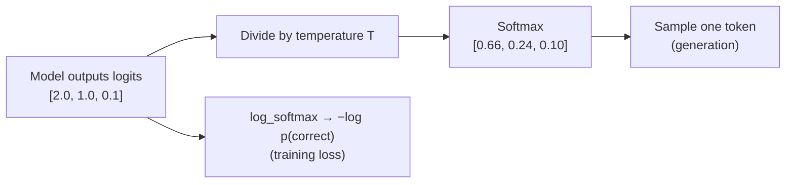

# 01/06 Probability and Distributions

> How an LLM turns raw scores into a chosen token: logits → temperature → softmax → sample.

**Done:** 2026-10-10 · Quiz 3/3 · Bridge lesson 3 of 14
**Lesson:** [phases/01-math-foundations/06-probability-and-distributions](../phases/01-math-foundations/06-probability-and-distributions/)
**My code:** [`labs/01-06-probability-and-distributions/my_sampling.py`](../labs/01-06-probability-and-distributions/my_sampling.py). I wrote softmax, log_softmax, cross_entropy and the sampler, and all 8 checks pass.
**Run it:** `python3 labs/01-06-probability-and-distributions/my_sampling.py` (no numpy needed)

---

## Remember these 3 things

1. **Softmax turns any list of scores into probabilities** (all positive, summing to 1). Subtract the max score first so `exp` can't overflow. The result is the same.
2. **Temperature divides the scores before softmax.** Low T makes the output sharper and more predictable. High T makes it flatter and more random. T only affects *generation*, not training.
3. **Cross-entropy loss = −log(probability the model gave the right answer).** Compute it with **log_softmax**, never `log(softmax(...))`, which can produce log(0).

---

## The big picture



- **Logits** are the raw scores the model gives each token in its vocabulary. They can be any number: negative, large, anything.
- **Probabilities** are the logits pushed through softmax.
- **Generation** samples from those probabilities. **Training** measures how much probability went to the right token.

---

## Softmax

**What it does.** Make every score positive (`exp`), then divide by the total so they sum to 1:

```text
softmax(z)_i = exp(z_i) / sum over j of exp(z_j)
```

**Worked example.** `z = [2, 1, 0.1]`:
- `exp` gives [7.39, 2.72, 1.11], which sum to 11.21.
- Dividing gives **[0.659, 0.242, 0.099]**.

**The stability trick.** `exp(1000)` overflows to infinity. But adding or subtracting the same number from every score doesn't change softmax (the `exp(c)` factor cancels top and bottom). So subtract the max first. The biggest exponent becomes `exp(0) = 1` and nothing overflows.

My code:

```python
def softmax(logits, temperature=1.0):
    if temperature <= 0:
        raise ValueError("temperature must be > 0")   # dividing by 0 or a negative T makes no sense
    scaled = [l / temperature for l in logits]        # 1. apply temperature
    m = max(scaled)
    shifted = [s - m for s in scaled]                 # 2. subtract the max (stability)
    denom = sum(math.exp(s) for s in shifted)
    return [math.exp(s) / denom for s in shifted]     # 3. exp and normalise
```

---

## Temperature

Same logits `[2, 1, 0.1]`, three temperatures:

| T | Divided logits | Probabilities | Feel |
|---|---------------|---------------|------|
| 0.5 | [4, 2, 0.2] | **[0.864, 0.117, 0.019]** | Sharp: the top token dominates |
| 1 | [2, 1, 0.1] | [0.659, 0.242, 0.099] | The model's natural distribution |
| 2 | [1, 0.5, 0.05] | [0.502, 0.304, 0.194] | Flat: more variety |

**Why it works.** Dividing by a small T *stretches* the gaps between scores, and softmax turns bigger gaps into more lopsided probabilities. A large T shrinks the gaps.

| Setting | Use it for |
|---------|-----------|
| T ≈ 0 | Almost always the top token (deterministic). Extraction, classification, tool calls, JSON output. |
| T ≈ 0.7 to 1 | Normal chat |
| T > 1 | Brainstorming. More random, and more likely to go off the rails. |

---

## Cross-entropy (the training loss)

For one example where the correct token is index `t`:

```text
loss = −log( softmax(z)[t] )
```

**Worked example.** `z = [2, 1, 0.1]`:
- If the correct token is index 0 (p = 0.659), the loss is −ln(0.659) = **0.417**. The model was fairly confident and right, so the loss is small.
- If the correct token is index 2 (p = 0.099), the loss is −ln(0.099) = **2.317**. The model gave the right answer little probability, so the loss is big.

**Why log_softmax, not log(softmax).** For `z = [1000, 0]`:
- softmax gives [1.0, 0.0], because the second probability underflows to exactly 0.
- Then log(0.0) = −infinity, and training crashes.

log_softmax computes the log directly: `z_i − log(sum exp(z_j))`, using the same max-shift trick on the sum (called **log-sum-exp**). It gives `[0, −1000]`, a finite and correct answer.

My code:

```python
def log_softmax(logits):
    m = max(logits)
    lse = m + math.log(sum(math.exp(l - m) for l in logits))   # stable log(sum(exp(z)))
    return [l - lse for l in logits]

def cross_entropy(logits, target_index):
    return -log_softmax(logits)[target_index]
```

**PyTorch connection.** `F.cross_entropy(logits, target)` runs log_softmax *inside*. Feed it **raw logits**. If you apply softmax first, softmax runs twice and you risk log(0). This has nothing to do with temperature. I mixed that up in the lesson.

---

## Sampling one token

Picture the probabilities laid end to end on a ruler from 0 to 1. Each token owns a slice as wide as its probability. Throw a dart at a random spot r in [0, 1). The slice it lands in is the token you sample.

```text
probs = [0.66, 0.24, 0.10]
slices:  [0 ......... 0.66)[0.66 .... 0.90)[0.90 .. 1.0)
          token 0            token 1          token 2
r = 0.75 → falls in token 1's slice
```

My code (current file):

```python
def sample_categorical(probs, rng):
    r = rng.random()
    cumulative = 0.0
    for i, val in enumerate(probs):
        cumulative += val
        if cumulative >= r:        # ⚠ see note below: r < cumulative is safer
            return i
    return len(probs) - 1          # float rounding: the probs may sum to 0.9999999
```

- **The fallback must be the *last* index, not 0.** This was a review point and I fixed it.
- **Edge case still in my file:** with `>=`, a token with probability 0 can still win when r is exactly 0.0, because `cumulative` is still 0 and `0 >= 0` is true. Using `if r < cumulative:` means a zero-width slice can never be hit.

---

## Where this shows up in AI engineering

- **API settings:** `temperature`, `top_p` and `top_k` all reshape this distribution before sampling.
- **Deterministic pipelines** (extraction, routing, tool calls) use low temperature for repeatable output.
- **`logprobs` from an API** are log_softmax outputs. You can use them as a confidence score. More on that in [01/09](01-09-information-theory.md).
- **Fine-tuning loss** is exactly this cross-entropy, averaged over every token.

## Mistakes to avoid

- `log(softmax(z))`: use log_softmax.
- Applying softmax before `F.cross_entropy`: pass raw logits.
- Sampler fallback `return 0`: it should be `return len(probs) - 1`.
- `>=` vs `<` in the sampler: `r < cumulative` is the safe comparison.
- Thinking temperature changes training: it's a decoding-time knob only.

## Words

- **Logit:** a raw, unnormalised score. Any real number.
- **Distribution:** a set of probabilities over outcomes that sums to 1.
- **Categorical distribution:** a distribution over a fixed list of choices, like tokens.
- **PMF vs PDF:** a PMF is for countable outcomes, and its probabilities sum to 1. A PDF is for continuous values, and its density integrates to 1. A single PDF value can be above 1.

## Connects to

- **Before:** [01/10 Dimensionality Reduction](01-10-dimensionality-reduction.md)
- **Next:** [01/09 Information Theory](01-09-information-theory.md). Cross-entropy, viewed as "surprise".

---

## Self-test

1. Why subtract the max logit before `exp`, and why doesn't it change the answer?
2. What happens to `[2, 1, 0.1]` at T = 0.1? At T = 10?
3. The correct token got probability 0.5. What is the cross-entropy loss, in nats?
4. Why is `log(softmax(z))` dangerous? Give an input that breaks it.
5. Your model's last layer is `nn.Softmax`, followed by `F.cross_entropy`. What's wrong?
6. You need the same JSON output every time. What temperature do you use?

<details>
<summary>Answers</summary>

1. It prevents `exp` overflow. Softmax is shift-invariant: the `exp(−max)` factor appears in the top and the bottom and cancels.
2. T = 0.1 puts more than 99.9% on index 0, essentially argmax. T = 10 gives nearly equal thirds.
3. −ln(0.5) ≈ 0.693.
4. Small probabilities underflow to 0.0, and log(0) is −∞. Example: `[1000, 0]`.
5. Softmax is applied twice (F.cross_entropy applies log_softmax itself). Remove the softmax layer and output logits.
6. T = 0, or as low as the API allows.

</details>
