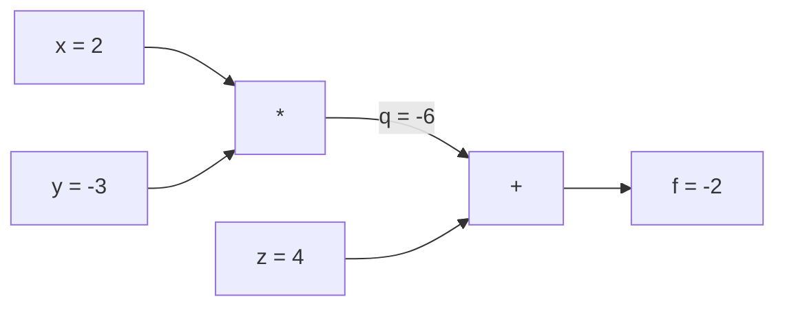

# 03/03 Backpropagation

> One forward pass, one backward pass, and every weight's gradient. That's what makes training possible.

**Done:** 2026-10-22 · Quiz 3/3 · Bridge lesson 7 of 14
**Lesson:** [phases/03-deep-learning-core/03-backpropagation](../phases/03-deep-learning-core/03-backpropagation/)
**My code:** [`labs/03-03-backpropagation/my_autograd.py`](../labs/03-03-backpropagation/my_autograd.py). I wrote the backward passes for `+`, `*`, sigmoid and the topological `backward()`. 8/8 checks passed on the first try, and my engine trains XOR.
**Run it:** `python3 labs/03-03-backpropagation/my_autograd.py` (no numpy needed)

---

## Remember these 3 things

1. **Every node does one job: `input.grad += local derivative × out.grad`.** Know three local rules: `+` routes the gradient through, `*` swaps the values, sigmoid multiplies by `s(1 − s)`.
2. **Use `+=`, because a value used twice gets the sum of both paths.** That's also why you call `zero_grad()` before every backward pass.
3. **Walk the graph in reversed topological order (loss first),** so each node has its full gradient before passing it on. Sigmoid shrinks the gradient by at least 4× per layer, so deep sigmoid stacks vanish. Residual `x + layer(x)` gives a "× 1" highway that fixes this.

---

## In plain English

Training needs to know, for **every** weight, "if I nudge you up a little, does the loss go up or down, and by how much?" That number is the **gradient**, dL/dw.

- **The slow way:** nudge one weight, rerun the whole model, and measure the change. One forward pass *per weight*, so 2.3 million passes for a single 768×3072 layer, every training step. Impossible.
- **Backprop:** a forward pass that records every small operation in a graph, then a backward pass from the loss that applies the chain rule at each node. **All the gradients for the cost of about two passes.**

**Analogy.** A relay race run backwards. The loss hands a baton (the gradient) to the node that produced it. Each node scales the baton by how sensitive its output is to each input (its local derivative) and hands the result to each of its inputs. If a node has two outgoing paths, it waits to receive both batons and adds them together.

---

## The chain rule on a tiny graph

```text
x = 2, y = -3, z = 4
q = x * y   = -6
f = q + z   = -2
```



The backward pass, step by step:

| Step | Node | Rule | Result |
|------|------|------|--------|
| 1 | f | seed: df/df = 1 | f.grad = 1 |
| 2 | `+` | router: pass the gradient through unchanged | q.grad = 1, z.grad = 1 |
| 3 | `*` | swap: each input gets the other's value × upstream | x.grad = y × 1 = **−3**, y.grad = x × 1 = **2** |

**Sanity check by nudging:** x from 2 to 2.1 makes q = −6.3 and f = −2.3. f changed by −0.3 for a +0.1 nudge, so the slope is −3. ✔

**The chain rule in one line:** `df/dx = df/dq × dq/dx = 1 × y = −3`.

---

## Local derivatives to know cold

| Node | Forward | Local derivative | Nickname |
|------|---------|------------------|----------|
| `a + b` | sum | 1 for both inputs | **Router** |
| `a * b` | product | ∂/∂a = **b**, ∂/∂b = **a** | **Swap** |
| `sigmoid(z)` | s = 1 / (1 + e^−z) | **s(1 − s)**, reusing s from the forward pass | **Damper** (at most 0.25) |
| `(a − y)²` | squared error | 2(a − y) | |

---

## A value used twice: why `+=`

```text
f = x*y + x*z     with x = 2, y = -3, z = 4
```

x feeds two `*` nodes. Path 1 gives y = −3 and path 2 gives z = 4. So **df/dx = −3 + 4 = 1**.

- With `=`, x.grad becomes −3 or 4 depending on which backward ran last. That's a silent, order-dependent bug.
- With `+=`, the gradients add up correctly. `x * x` works the same way: both lines add 3 to the same `.grad`, giving 6 = 2x.
- **Consequence:** gradients also accumulate *across* training steps, so you must reset them (`zero_grad()`) before every backward pass.

---

## Worked example: a 2-layer network (computed with my engine)

`x = 1, w1 = 0.5, b1 = 0, w2 = −1, b2 = 0.5`, target `y = 0`, loss `L = (a2 − y)²`.

**Forward (left to right):**

| Quantity | Formula | Value |
|----------|---------|-------|
| z1 | w1·x + b1 | 0.5 |
| a1 | sigmoid(z1) | 0.6225 |
| z2 | w2·a1 + b2 | −0.1225 |
| a2 | sigmoid(z2) | 0.4694 |
| L | (a2 − 0)² | 0.2204 |

**Backward (right to left):**

| Gradient | How | Value |
|----------|-----|-------|
| dL/da2 | 2(a2 − y) | 0.9388 |
| dL/dz2 | × a2(1 − a2) = 0.249 | 0.2338 |
| dL/dw2 | × a1 (swap) | **0.1456** |
| dL/db2 | × 1 (router) | 0.2338 |
| dL/da1 | × w2 = −1 (swap) | −0.2338 |
| dL/dz1 | × a1(1 − a1) = 0.235 | −0.0550 |
| dL/dw1 | × x = 1 | **−0.0550** |

**Reading the signs.** The prediction is 0.47 but the target is 0, so we want a smaller output.
- dL/dw2 is **positive**, so *decrease* w2.
- dL/dw1 is **negative**, so *increase* w1. A bigger a1, multiplied by the negative w2, lowers z2.

Gradient descent `w -= lr × grad` does both automatically.

---

## My code

```python
def __add__(self, other):
    ...
    def _backward():
        self.grad += out.grad                  # router
        other.grad += out.grad

def __mul__(self, other):
    ...
    def _backward():
        self.grad += other.data * out.grad     # swap
        other.grad += self.data * out.grad

def sigmoid(self):
    ...
    def _backward():
        self.grad += s * (1 - s) * out.grad    # reuse s from the forward pass

def backward(self):
    topo, visited = [], set()
    def build_topo(v):
        if v not in visited:
            visited.add(v)
            for child in v._children:
                build_topo(child)              # children first...
            topo.append(v)                     # ...then me, so I come after everything I depend on
    build_topo(self)
    self.grad = 1.0                            # dL/dL = 1
    for v in reversed(topo):                   # loss first, inputs last
        v._backward()
```

**Why reversed?** For `x*y + z` walked *forwards*, the `*` node's backward runs while q.grad is still 0, so x.grad stays **0**. Every node must receive its full upstream gradient before it passes anything down.

**Review note:** `build_topo` is recursive, and Python's default recursion limit is about 1000, so a very deep graph raises `RecursionError`. Production engines use an iterative DFS with an explicit stack.

---

## Vanishing gradients, and the fix

| z | sigmoid(z) | derivative s(1 − s) |
|---|-----------|---------------------|
| 0 | 0.5 | **0.25** (the maximum possible) |
| 2 | 0.881 | 0.105 |
| 5 | 0.993 | 0.0066 (saturated) |

Each sigmoid layer multiplies the gradient by **at most 0.25**. After 10 layers that's at most 0.25¹⁰ ≈ 10⁻⁶.

**Measured with my engine:** in a 10-layer sigmoid chain, layer 1's gradient was **9.85e-08** and layer 10's was **0.147**, about 1.5 million times smaller. Layer 1 is effectively frozen.

**Fixes:**
- **ReLU** (next lessons): its derivative is 1 for positive inputs, so it doesn't damp the gradient.
- **Residual connections:** `out = x + layer(x)`. Through the `+`, x receives the upstream gradient **× 1**, unchanged, however badly `layer(x)` squashes its own path. Stack 96 layers and there's still a path made only of × 1 steps: the **gradient highway**. This is why transformers can be very deep. (It was placement question Q6, which I missed and now understand.)

---

## PyTorch mapping

```python
opt.zero_grad()     # my net.zero_grad()
loss.backward()     # my Value.backward()
opt.step()          # my p.data -= lr * p.grad
```

| Mine | PyTorch |
|------|---------|
| `Value` | `Tensor` (many numbers, GPU) |
| `_children` + `_backward` | `tensor.grad_fn` graph |
| `+=` into `.grad` | Same, hence `zero_grad()` |
| `Neuron` / `MLP` | `nn.Linear` / `nn.Sequential` |

**Inference:**
- **`torch.no_grad()`** means no graph is recorded, so no activations are kept for a backward pass. That saves memory and time. LLM serving uses it.
- **`model.eval()`** is a different thing. It switches dropout and batch-norm to inference behaviour. Serving uses both.

---

## Where this shows up in AI engineering

- **Fine-tuning and LoRA** (Phase 11): backprop computes the gradients. LoRA only changes *which* weights receive updates.
- **Debugging training:**
  - loss not moving → vanishing gradients, or a forgotten `zero_grad`
  - loss becomes NaN → exploding gradients, so clip them
- **Serving cost:** the memory saved by `no_grad()` turns into larger batches per GPU.
- **Interviews:** "Explain backprop", "Why `zero_grad()`?", "Why do residual connections help?". All three answers are in this sheet.

## Mistakes to avoid

- Using `=` instead of `+=` in a backward function (wrong when a value is reused).
- Forgetting `zero_grad()`, so gradients pile up across steps.
- Walking the topo order forwards. Inputs get 0 gradient.
- Confusing `model.eval()` with `torch.no_grad()`.

## Words

- **Gradient:** how much the loss changes per unit nudge of a parameter. Its sign says which way to move the parameter.
- **Computational graph:** the record of every operation from the inputs to the loss.
- **Topological order:** an ordering where each node comes after everything it was computed from.
- **Autograd:** automatic construction of the graph plus the backward pass.
- **Saturation:** sigmoid's input is so large in magnitude that its derivative is almost 0.

## Connects to

- **Before:** [02/17 Imbalanced Data](02-17-imbalanced-data.md). The weighted gradient `X.T @ (w * (p − y))` I used there is exactly what this engine derives.
- **Next:** 03/05 Loss Functions. *What* we backprop: MSE vs cross-entropy, and why cross-entropy pairs well with softmax.

---

## Self-test

1. What does every node do during the backward pass, in one line?
2. `f = x*y + z` with x = 2, y = −3, z = 4. Give all three gradients.
3. `f = x*y + x*z`. What is df/dx, and what goes wrong with `=` instead of `+=`?
4. Why reversed topological order? What does x.grad become in `x*y + z` if you walk forwards?
5. What is the largest possible sigmoid derivative, and what does 10 layers of it do to the gradient?
6. Why does `out = x + layer(x)` stop gradients vanishing?
7. `torch.no_grad()` vs `model.eval()`?

<details>
<summary>Answers</summary>

1. `input.grad += local derivative × out.grad`.
2. x.grad = −3 (= y), y.grad = 2 (= x), z.grad = 1.
3. y + z = 1. With `=` you get −3 or 4, depending on which path's backward ran last.
4. A node must have its full gradient before passing it down. Forwards, the `*` node runs while q.grad = 0, so x.grad = 0.
5. 0.25, at z = 0. After 10 layers that's at most 0.25¹⁰ ≈ 10⁻⁶ of the original gradient.
6. The `+` routes the upstream gradient to x × 1, unchanged, so there's always a non-shrinking path back to early layers.
7. `no_grad()` stops graph recording (memory and speed). `eval()` changes dropout and batch-norm behaviour. Inference uses both.

</details>
