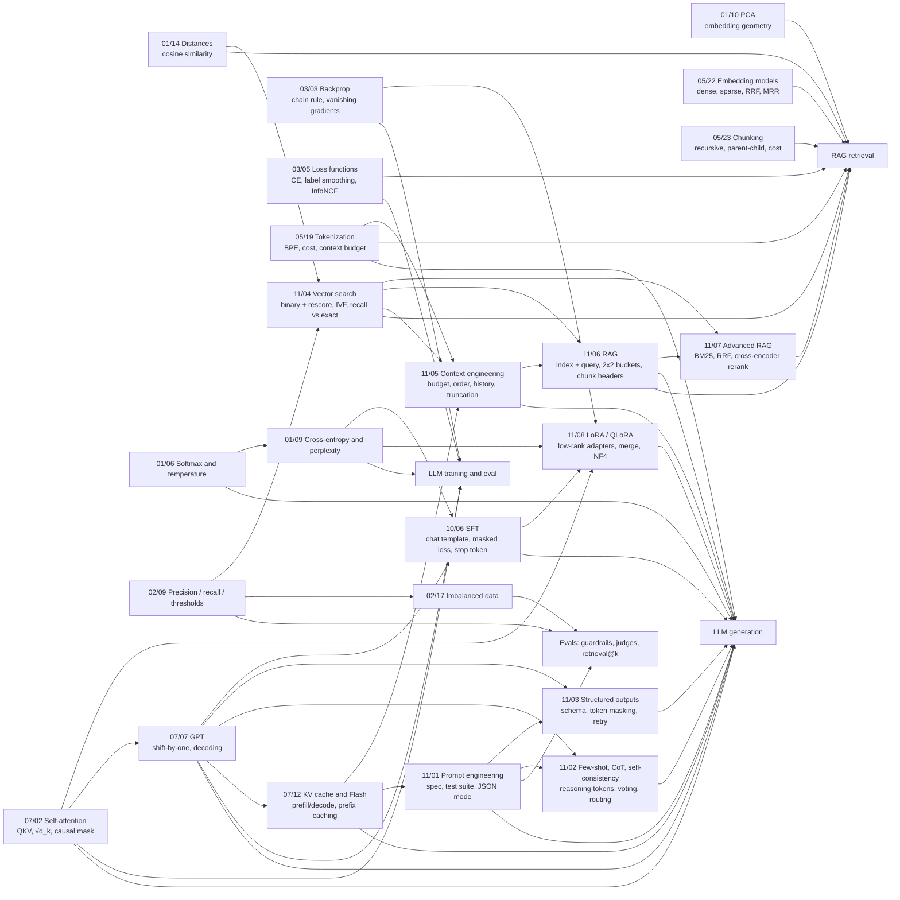

# Revision Notes

One sheet per finished lesson, written so I can come back after weeks away and rebuild the idea quickly.

## How to revise

**Before a new lesson (10 minutes):**
1. Open the sheets for the last one or two lessons.
2. Read only **"Remember these 3 things"** at the top.
3. Do the **Self-test** from memory, *then* open the answers.

**After a long break (a week or more, 30 to 45 minutes):**
1. Go through the sheets in order, from #1 down. For each, read "Remember these 3 things", then "In plain English", then redo the worked example by hand.
2. Do every Self-test.
3. For any sheet where I miss more than one question, re-run its practice file (the command is at the top of each sheet) and re-read **"Mistakes to avoid"**.

## How each sheet is laid out

| Section | What it gives me |
|---------|------------------|
| Remember these 3 things | The minimum to keep if I forget everything else |
| In plain English | The idea with no jargon, plus an everyday analogy |
| Worked example | Real numbers I can redo by hand to check I understand |
| Formulas / cheat sheet | Every symbol defined |
| My code | What I actually wrote, why each line is there, and fixes still to make |
| Where this shows up in AI engineering | Why I care, in LLM / RAG / agent terms |
| Mistakes to avoid | The errors I actually made, so I don't repeat them |
| Self-test | Questions, with answers that explain the reasoning |

## Index

| # | Lesson | Status | One-line summary | Sheet |
|---|--------|--------|------------------|-------|
| 1 | 01/14 Norms and Distances | Done 2026-10-08 (3/3) | Cosine compares direction. Unit vectors make cosine, dot and L2 agree. | [01-14](01-14-norms-and-distances.md) |
| 2 | 01/10 Dimensionality Reduction | Done 2026-10-08 (3/3) | PCA keeps the directions of largest spread. Center first. | [01-10](01-10-dimensionality-reduction.md) |
| 3 | 01/06 Probability and Distributions | Done 2026-10-10 (3/3) | Logits, then temperature, then softmax, then sample. The loss is −log p(correct). | [01-06](01-06-probability-and-distributions.md) |
| 4 | 01/09 Information Theory | Done 2026-10-11 (3/3) | Surprise = −log p. Perplexity = exp(loss). ln(V) means uniform guessing. | [01-09](01-09-information-theory.md) |
| 5 | 02/09 Model Evaluation | Done 2026-10-11 (3/3) | Precision vs recall. Turn the threshold toward the cheaper mistake. | [02-09](02-09-model-evaluation.md) |
| 6 | 02/17 Imbalanced Data | Done 2026-10-22 (3/3) | Weights, SMOTE or a threshold all move the boundary. Resample only the train fold. Judge with MCC and AUPRC. | [02-17](02-17-imbalanced-data.md) |
| 7 | 03/03 Backpropagation | Done 2026-10-22 (3/3) | Each node: input.grad += local × upstream. `+=` for reuse, reversed topo order. Sigmoid vanishes, residual `+` is a ×1 highway. | [03-03](03-03-backpropagation.md) |
| 8 | 03/05 Loss Functions | Done 2026-10-22 (3/3) | Classify with CE (gradient p − y, about 50× MSE when confidently wrong). Losses take logits. InfoNCE = softmax CE over similarities. | [03-05](03-05-loss-functions.md) |
| 9 | 05/19 Subword Tokenization | Done 2026-10-24 (3/3) | BPE merges the most frequent pairs, in order. Count tokens, never estimate. Explains strawberry, arithmetic and emoji. | [05-19](05-19-subword-tokenization.md) |
| 10 | 05/22 Embedding Models | Done 2026-10-24 (3/3) | Dense (meaning), sparse (exact codes), multi-vector (MaxSim). RRF fuses ranks. Follow the model card (prefix, re-normalise). Measure, because hybrid lost in my lab. | [05-22](05-22-embedding-models.md) |
| 11 | 05/23 Chunking for RAG | Done 2026-10-25 (3/3) | The chunk is what gets found and what gets shown. Recursive at boundaries is the default. Score hits *and* prompt tokens. Parents must be small relative to the doc. | [05-23](05-23-chunking.md) |
| 12 | 07/02 Self-Attention | Done 2026-10-26 (3/3) | softmax(QKᵀ/√d_k)·V. √d_k stops one-hot saturation. The causal mask blocks the future. Order-blind and O(n²). Torch: W.T and mask True = blocked. | [07-02](07-02-self-attention.md) |
| 13 | 07/07 GPT | Done 2026-10-27 (3/3) | Shift-by-one CE, trained in parallel, generated serially. Greedy loops. min-p adapts to the peak, top-p takes long tails (1,503 tokens on GPT-2). HF shifts labels for you. | [07-07](07-07-gpt.md) |
| 14 | 07/12 KV Cache and Flash Attention | Done 2026-10-28 (3/3) | Cache K and V (never Q). 128 KiB per token on Llama-3-8B, so cache memory decides users per GPU. Flash is exact: running max/sum, fewer HBM trips. Prefix cache = identical prefix, copied per request. | [07-12](07-12-kv-cache.md) |
| 15 | 11/01 Prompt Engineering | Done 2026-10-29 (3/3) | Role, context, constraints, format. Rules in system, data in tagged user. Prompt = schema, JSON mode = syntax (67% to 100%). Test on a case set with strict scoring and raw failures. T=0 is greedy. | [11-01](11-01-prompt-engineering.md) |
| 16 | 11/02 Few-Shot, CoT, ToT | Done 2026-10-29 (3/3) | Reasoning before the answer, or it's not CoT. On 3B: 0% to 83% with CoT. Few-shot examples set the format and length (21% fewer tokens). Self-consistency costs N×; its confidence is a routing signal. It can't fix systematic errors (use tools). | [11-02](11-02-few-shot-cot.md) |
| 17 | 11/03 Structured Outputs | Done 2026-10-30 (3/3) | Prompt < JSON mode (syntax) < schema mode (keys, types, enums) via token masking. Required + nullable, or the decoder invents values. Retry only with actionable feedback. No mode checks truth (HACKED passed). | [11-03](11-03-structured-outputs.md) |
| 18 | 11/04 Embeddings & Vector Representations | Done 2026-11-02 (3/3) | Two levers: compress (binary 32×) and skip (IVF/HNSW). Approximate search loses results silently, so measure recall vs exact offline, plus the task metric. Binary + rescore = 0.93. Under ~100k vectors, exact is faster. | [11-04](11-04-embeddings.md) |
| 19 | 11/05 Context Engineering | Done 2026-11-03 (3/3) | Fixed parts first (system, query, reserve), then docs by score (skip misfits), then history newest-first (stop at misfit). Query last, best docs at the edges. Ollama's default 2,048 window silently cut 4,645 tokens from the front, so assert seen ≥ 0.95 × sent. top-24 = 7× cost for zero gain. | [11-05](11-05-context-engineering.md) |
| 20 | 11/06 RAG | Done 2026-11-04 (3/3) | Offline (chunk, embed, store) + online (embed query, top-k, assemble, generate) share one contract. Grade the 2×2: gold retrieved × correct → success / generation / retrieval failure / suspicious, plus abstain vs hallucination. Plain "the Company" chunks 10/20; `[Company 10-K FY]` header 20/20. Wrong context → 10 confident wrong figures with citations. | [11-06](11-06-rag.md) |
| 21 | 11/07 Advanced RAG | Done 2026-11-05 (3/3) | BM25 (exact tokens: codes 16/16) and vectors (meaning: paraphrase 16/16) are blind in opposite places. RRF merge fell *below* vector (32 vs 39/48); cross-encoder rerank of the top-50 → 44/48 at 58 ms. Retrieve wide, rerank narrow. | [11-07](11-07-advanced-rag.md) |
| 22 | 11/08 LoRA & QLoRA | Done 2026-11-05 (3/3) | Frozen W + trainable B·A (B = 0 init). GPT-2: 0.24% params, Adam 2.2 MB vs 949 MB, format 40/40 like full FT (3-shot: 7/40), exact only 26/40 (digits). LoRA still forgot (ppl 26.4 → 33.6). NF4 +1.3 ppl vs int4 +3.0. Merge = same model, no overhead. | [11-08](11-08-lora.md) |
| 23 | 10/06 Instruction Tuning (SFT) | Done 2026-11-06 (3/3) | Same next-token loss, but graded only on assistant tokens + `<|im_end|>` (labels -100 elsewhere, mean over kept). Base GPT-2: 0/45 stops → SFT 45/45, 37/45 correct on unseen prompts (facts from pre-training). Masked end token: 0/45 stops. No mask: writes prompts. lr 3e-4: ppl 2,315. | [10-06](10-06-instruction-tuning-sft.md) |

## How it all connects

- **Cosine similarity** is how a vector database picks the "relevant" chunks.
- **PCA and high-dimensional geometry** explain embedding compression and why distances get less useful as the number of dimensions grows.
- **Softmax and temperature** are how an LLM chooses its next token.
- **Cross-entropy and perplexity** are what an LLM is trained on and evaluated with.
- **Precision, recall and thresholds** are how I'll score guardrails, LLM judges and retrieval.
- **Imbalanced-data techniques** matter because the things worth catching (attacks, hallucinations, fraud) are rare.
